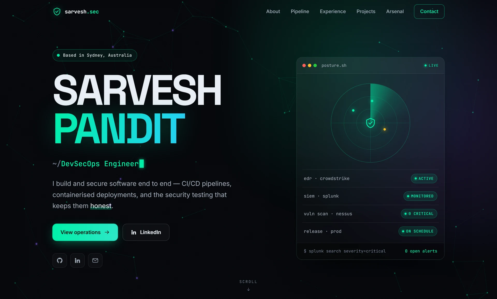

<div align="center">

<a href="https://sarveshp16.github.io">
  
</a>

<h1>Sarvesh Pandit</h1>

<p>
  <b>Security Engineer · DevSecOps</b><br>
  Hardening the path from commit to production.
</p>

<p>
  <a href="https://sarveshp16.github.io"><b>sarveshp16.github.io&nbsp;&nbsp;→</b></a>
</p>

<p>
  
  
  
  
  
</p>

</div>

<br>

## About

The source for my personal site. Plain HTML, CSS and JavaScript with no
framework and no build step, served by GitHub Pages straight from `main`.

## Run it locally

```bash
python -m http.server 8000
```

Then open <http://localhost:8000>.

After a fresh clone, switch on the pre-commit hook once. It version-stamps the
CSS and JS links so visitors never get a mix of old and new files:

```bash
git config core.hooksPath .githooks
```

<br>

<div align="center">
  <sub>© 2026 Sarvesh Pandit · <a href="https://sarveshp16.github.io/#contact">Get in touch</a></sub>
</div>
